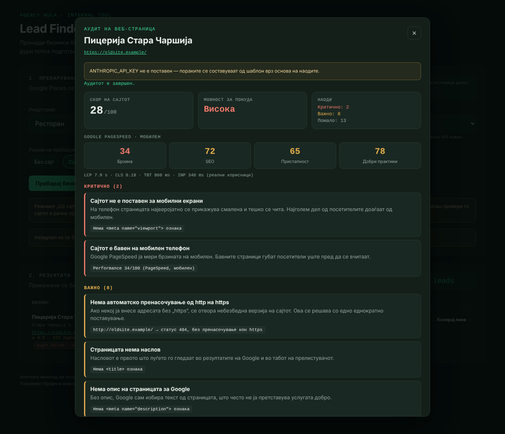
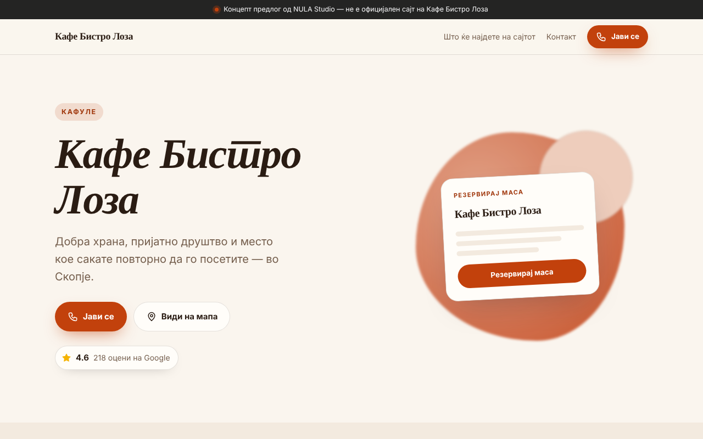
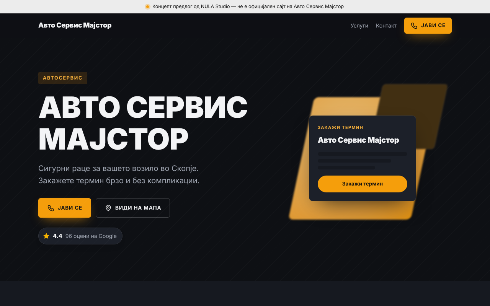
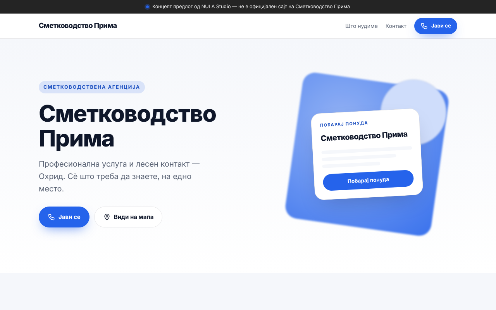

# NULA Lead Finder

A lightweight lead-research tool for finding local businesses that have no website — or a weak one — auditing their site, and preparing personalised, evidence-based outreach for potential web-development clients.

## Overview

NULA Lead Finder was built as an internal business-development tool for NULA Studio.

The application uses Google Places data through Netlify serverless functions. It can show businesses without a website (the original workflow), businesses with a website that are candidates for an audit and redesign, or both. For a business with a website it runs a technical audit (HTML checks + Google PageSpeed Insights), scores the site, and drafts a polite message based only on the measured findings. For any lead it can generate a one-page concept preview link that can be sent to the business.

It does **not** automatically message businesses. Every message is reviewed, edited and sent manually.

## Features

- Search businesses by category and city
- Google Places integration
- Search mode: **Без сајт** (no website, default), **Со сајт (за аудит)** (has a website), **Сите** (all) — filtered server-side
- Google rating and review count per lead
- Google Maps links for manual verification
- Manual Instagram search workflow
- Lead status tracking (including **Не контактирај**, which blocks message generation)
- Template outreach messages for businesses without a website (offers + tones)
- **Website audit** for businesses with a website: around 20 HTML/technical checks, robots.txt and sitemap.xml, Google PageSpeed Insights (mobile) scores and Core Web Vitals
- Site score 0–100 and an opportunity label (**Висока / Средна / Ниска**)
- **Personalised message from real findings** for Email, Instagram DM or Viber — via the Anthropic API when configured, otherwise a deterministic template composer
- **Concept preview**: a one-page website concept rendered client-side from a link (four category templates), with "Прегледај концепт" and "Копирај линк" per lead
- Local persistence of lead status, audit summaries and prepared messages
- CSV export (including website, rating, audit score, opportunity and audit message)
- Basic API-usage counter
- API keys protected through Netlify environment variables
- Security headers and a strict Content Security Policy configured through Netlify
- Unit tests (Vitest), linting (ESLint) and GitHub Actions CI

## Workflow

1. Choose a business category, location and search mode.
2. Search through Google Places.
3. **No website:** verify the business manually through Google Maps and Instagram search, choose an offer and tone, generate and edit the message.
4. **Has a website:** open **Аудит**, run the audit and review the findings, PageSpeed scores and opportunity label. Check the site yourself as well.
5. Choose channel (Email / Instagram DM / Viber), offer and tone, then **Генерирај порака**. Edit the message — it is a draft, not a final text.
6. Optionally open **Прегледај концепт** or copy the concept link to include in the outreach.
7. Send the message manually, then mark the lead status.
8. Export the results when needed.

## Screenshots

| Website audit | Concept preview — food / café |
| --- | --- |
|  |  |

| Concept preview — auto services | Concept preview — generic business | Concept preview — beauty (mobile) |
| --- | --- | --- |
|  |  |  |

The screenshots use sample data and mocked API responses.

## Tech Stack

- **HTML**
- **CSS**
- **Vanilla JavaScript** (ES modules, no framework, no build step)
- **Google Places API**
- **Google PageSpeed Insights API v5**
- **Anthropic Messages API** (optional)
- **Netlify Functions**
- **Netlify**
- **Browser localStorage**
- **Vitest + ESLint** (development only)

## Architecture

```text
index.html, app.js, styles.css      Main tool (Macedonian UI)
preview.html, preview.js,           Client-side concept preview (no server storage)
preview.css
js/preview-codec.js                 Preview link encode/decode + sanitising (shared, pure)
netlify/functions/
  places-search.mjs                 Google Places proxy, search mode filter
  site-audit.mjs                    Website audit endpoint
  generate-message.mjs              Audit-based message (Anthropic or template)
netlify/lib/
  audit.mjs                         Pure HTML analysers, findings, score formula
  ssrf.mjs                          URL validation, SSRF guard, bounded fetch
  psi.mjs                           PageSpeed Insights request + response parsing
  message-composer.mjs              Deterministic template composer (fallback)
  http.mjs                          Shared JSON / validation helpers
tests/                              Vitest suites + fixtures
```

All API keys stay server-side. The browser only talks to the three functions on the same origin. Lead notes, statuses, settings, audit summaries and prepared messages are stored locally in the browser for this version of the tool.

The concept preview carries its data (name, category, city, address, phone, Google rating/count, accent colour, template) in a base64url-encoded JSON parameter (`preview.html?c=…`). Nothing is stored on the server, so the link can be sent directly to the business.

### Audit checks

| Area | Check |
| --- | --- |
| Security | HTTPS used; http → https redirect; mixed content (http assets on an https page) |
| Mobile | Viewport meta with `width=device-width`; click-to-call `tel:` link |
| SEO basics | Title present and length; meta description present and length; H1 count; `html lang`; robots.txt; sitemap.xml (or the sitemap declared in robots.txt) |
| Local business | schema.org `LocalBusiness` / `Organization` JSON-LD; Open Graph tags; favicon |
| Content | Images missing `alt`; HTML size; copyright year older than two years → "outdated" |
| Technology | Declared generator / CMS (WordPress + version, Wix, Joomla, Drupal, Shopify, …) |
| PageSpeed (mobile) | Performance, SEO, Accessibility, Best Practices scores; LCP, CLS, TBT; field INP when Google has real-user data |

Every finding has an id, a severity (critical / important / minor), a plain-language Macedonian title and explanation written for a business owner, and the evidence it is based on (for example `LCP 7.9 s`). Only measured values are reported. If PageSpeed fails or times out, the HTML findings are still returned with `psi: null` and a reason.

### Score formula

```text
technicalScore = max(0, 100 − Σ weights of HTML/network findings)
                 weights: critical 20, important 8, minor 3
psiScore       = average of the available PageSpeed category scores (0–100)
score          = round(0.6 × technicalScore + 0.4 × psiScore)   if PageSpeed returned scores
               = technicalScore                                otherwise

opportunity    = Висока (score < 50) · Средна (50–74) · Ниска (≥ 75)
```

PageSpeed-derived findings are displayed but not deducted, so performance is not counted twice. A weak site means a high opportunity.

### Message generation

- **No website:** the original template generator in `app.js` (offers + tones), unchanged.
- **Has a website:** `generate-message` sends the business data, the top findings, the chosen offer, tone and channel to the Anthropic Messages API. The system prompt requires: only the provided findings, at most 3 problems, no invented statistics or promises, no claims about the business beyond the data, polite and concrete language, one clear call to action, signed as NULA Studio. Business data is treated as untrusted input. Model output that contains numbers not present in the input data is rejected.
- **Fallback:** without `ANTHROPIC_API_KEY`, or on any API error, timeout or rejected output, a deterministic composer builds the message from the top 3 findings using the same tone/offer system. The UI shows which path was used.

## Local / Deployment Setup

The site deploys as static files plus functions with **no build step** (`publish = "."` in `netlify.toml`). The functions have no npm runtime dependencies; `package.json` only contains development tooling. Netlify will install those dev dependencies during deploy because a `package.json` is present; they are not used at runtime.

In Netlify, configure these environment variables:

| Variable | Required | Purpose |
| --- | --- | --- |
| `GOOGLE_PLACES_API_KEY` | Yes | Google Places search |
| `PAGESPEED_API_KEY` | No | PageSpeed Insights. Works without a key, but only on a small shared quota that often fails |
| `ANTHROPIC_API_KEY` | No | AI-written audit messages. Without it the template composer is used |
| `ANTHROPIC_MODEL` | No | Model id, default `claude-sonnet-5-5` (for example `claude-haiku-5-5` for lower cost) |

For PageSpeed, enable **PageSpeed Insights API** in the Google Cloud project and create an API key restricted to that API.

Then deploy the repository with the included `netlify.toml`.

Development:

```bash
npm install
npm test          # Vitest
npm run lint      # ESLint
npx netlify dev   # optional: run the site and functions locally with the Netlify CLI
```

The main page can be opened from a static server, but search, audit and message generation need the Netlify functions.

## Security

- API keys are read only from server-side Netlify environment variables and are never returned in responses or error messages.
- Local `.env` files are excluded from Git.
- **Rate limits** (per IP/domain, Netlify function config): Places proxy 20 requests / 60 s, site audit 10 / 60 s, message generation 10 / 60 s. Request bodies are size-limited and every input is validated and length-capped.
- **SSRF protection** for the audit (`netlify/lib/ssrf.mjs`):
  - only `http`/`https`, max URL length 2048, no credentials in the URL, default ports only, no `localhost` / `.local` / single-label hostnames;
  - IP literals are normalised by the URL parser first, so decimal, hex, octal and short forms (`http://2130706433/`, `http://0x7f000001/`, `http://127.1/`) are caught;
  - DNS is resolved and every address must be public: private, loopback, link-local, multicast, CGNAT (100.64/10), reserved/documentation ranges and IPv6 local ranges (`::1`, `fc00::/7`, `fe80::/10`, IPv4-mapped, NAT64 and 6to4 embeddings) are rejected;
  - the check runs again at socket connect time (protects against DNS rebinding) and on every redirect hop; max 5 redirects; ~8 s timeout; bodies capped at 2 MB after decompression; only `text/html` is parsed. robots.txt and sitemap.xml use the same guard.
- **Content Security Policy:** `default-src 'self'`, no inline scripts or styles. All code is in external files; the preview sets its accent colour through the CSSOM, which the policy allows. The CSP did not need to change for the new features.
- **XSS:** user-controlled data (Places data, audit findings, preview parameters) is escaped or rendered with `textContent`; the preview never uses `innerHTML` with link data.
- CSV export escapes values that could be interpreted as spreadsheet formulas.
- Tests, function sources and tooling files in the published root are answered with 404 by `netlify.toml`.
- Configure Google Cloud quotas/budgets for the Places and PageSpeed APIs, and a spending limit for the Anthropic API, as an additional cost-control layer.

Never commit real API keys, credentials, exported lead data, or local environment files to this repository.

## Limits

- **Heuristics:** the HTML audit uses pattern matching on the delivered HTML, not a full browser. Sites that render content with JavaScript, block bots (403/429) or use unusual markup can produce false positives or false negatives. Always check the site manually before contacting anyone.
- **PageSpeed:** a full mobile run usually takes 10–30 s. Without `PAGESPEED_API_KEY` the shared quota is small and requests often fail; the audit then continues without PSI data. Field data (INP) only appears when Google has enough real-user samples.
- **Costs:** Places and PageSpeed calls count against your Google Cloud quota. Each AI message is one Anthropic API call (roughly 1–2k input tokens), billed to your Anthropic account.
- **Storage:** everything is kept in this browser's localStorage; clearing it removes the lead history. Export CSV regularly.
- **Concept preview:** the copy is generic sample text per category group and is labelled as such on the page.

## Ethics

The tool never sends messages automatically. Outreach is manual: read and adjust every draft, contact each business at most through one appropriate channel, respect anti-spam and data-protection rules, and honour the **Не контактирај** status — the app will not generate messages for those leads. The concept preview clearly states that it is a concept by NULA Studio and not the official site of the business, and it never shows fake reviews or testimonials; only the real Google rating and review count are used when available.

## Why I built it

The goal was to solve a real workflow problem: finding potential clients, reducing repetitive research, and preparing more relevant outreach without fully automating communication.

This project combines frontend development, API integration, serverless functions, security hardening, automated testing, business-process design, and practical automation.

Built with AI-assisted development; product idea, workflow and validation by the author.

## Author

**Riste Kozarev**  
Founder, NULA Studio  
https://agencynula.com/

Portfolio: https://riste-kozarev.netlify.app/
